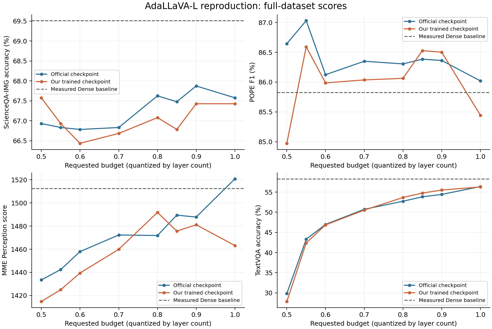

# AdaLLaVA-L 复现归档（ICCV 2025）

本分支 `adallava` 保存 AdaLLaVA-L / LLaVA-1.5-7B 的实际训练与评测代码、固定依赖、settings 和结果。`main` 是论文索引，以后每篇论文使用独立分支。

完成全量 665K 指令数据训练和四个基准评测。ScienceQA-IMG、POPE F1、TextVQA 在与论文共有的三个预算点上偏差均小于 1 个百分点；MME 有明确差距。按实验决策保留本次结果，不重训、不为追分重跑完整评测。“作者可能挑选了最好 checkpoint”只是可能解释，没有证据确认；没有多 seed 实验估计方差。

**Git 不保存权重、checkpoint、数据集、凭据或服务器连接脚本。换服务器需要下载数据集、LLaVA 底座和 CLIP 权重，并重新执行环境与 smoke/resume 验证。**

## 内容和固定来源

| 内容 | 位置 |
|---|---|
| 官方源码及原有许可声明 | [`vendor/`](vendor/) |
| 当时实际执行的脚本，保留旧路径作为证据 | [`reproduction/`](reproduction/) |
| 新服务器目录生成、部署及新评测入口 | [`tools/`](tools/) |
| settings 严格对齐审查 | [`STRICT_ALIGNMENT_REVIEW.md`](docs/training_repro/STRICT_ALIGNMENT_REVIEW.md) |
| 完整结果、速度、MME 分析及精确数据 | [`RESULTS_20261031.md`](docs/evaluation_repro/RESULTS_20261031.md) |
| 数据来源与保留位置 | [`DATASETS.md`](DATASETS.md) |
| 源码 revision、原始 pip 快照与数据 manifest | [`provenance/`](provenance/) |

| 上游 | 固定 commit |
|---|---|
| [AdaLLaVA](https://github.com/zhuoyan-xu/AdaLLaVA) | `2a020d90973b1a387c75a042e68a1194e32757d2` |
| [LLaVA](https://github.com/haotian-liu/LLaVA) | `c121f0432da27facab705978f83c4ada465e46fd` |
| [lmms-eval](https://github.com/EvolvingLMMs-Lab/lmms-eval) | `80391ce3bfb5a19b32e7a19a2d9399e1378ed2dd` |

AdaLLaVA 和 LLaVA tracked 源码未改。lmms-eval 的实际 YAML 修改见 [`lmms-eval.patch`](provenance/lmms-eval.patch)：公开数据访问、固定 revision、TextVQA OCR 开启。迁移工具只改生成目录中的路径、存储检查和新数据准备依赖。新迁移入口通过 CPU/Linux 部署检查，未重新做 GPU 训练；原始训练验证记录另行保留。

## 本次训练 settings

| 项目 | 实际配置 |
|---|---|
| 初始化 | `liuhaotian/llava-v1.5-7b` + 新 Scheduler；没有从官方 Ada checkpoint 继续训练 |
| 训练范围 | LLM、projector、Scheduler 联合训练；冻结 CLIP |
| Scheduler | L；前 16 层固定执行；32 个 LLM 层；token_selecting=none |
| 数据 | 完整 mix665k JSON，665,298 条，349,034 张不同图像，无人工筛样 |
| epoch / updates | 1 / 5,197；Trainer floor 规则使尾部 82 条未形成更新 |
| GPU / batch | 2 × RTX PRO 6000 Blackwell Server（每卡约 96 GiB）；micro 2 × 2 卡 × accumulation 32 = global 128 |
| 精度/attention | BF16，TF32，SDPA，gradient checkpointing |
| 优化器 | AdamW torch，β=(0.9,0.999)，ε=1e-8，weight decay=0 |
| LR | 1e-5，cosine，warmup ratio=0.03 |
| 有效梯度裁剪 | DeepSpeed 实际为 0（关闭），不是 Trainer 默认字段的 1 |
| 文本/图像 | max length 2048，image_aspect_ratio=pad，vision layer=-2，mlp2x_gelu |
| 数据加载 | lazy preprocess，group_by_modality_length，4 workers |
| seed | 42；显式在新 Scheduler 构造前设置 |
| 分布式/保存 | ZeRO-3，prefetch bucket=0；每 500 步保存，保留 1 个完整 checkpoint，成功保存后轮换，最终导出通用权重 |
| 参数量 | 总 7,080,802,832；可训练 6,777,295,376；Scheduler 17,900,048 |
| 结束 | 两个 rank 正常退出，step 5197，最后 loss=0.6608，最终 LR=0 |
| 成本 | 55.99 小时，111.97 GPU-hours；训练 FLOPs 未测量 |

环境：Python 3.10.22、torch 2.7.1+cu128、torchvision 0.22.1、Transformers 4.37.2、Accelerate 0.34.2、DeepSpeed 0.16.9，训练预加载 NCCL 2.31.2。完整列表见 [`requirements/`](requirements/) 及原始 pip 快照。Blackwell 兼容性调整、显式初始化 seed、GPU 拓扑均已在审查中说明。global batch 128 依据 Stage 2 上游配置及论文约 5,200 步曲线选择，**不是作者明确确认的 global batch**。

## 与论文和官方 checkpoint 对比

满预算 1.0。ScienceQA、POPE、TextVQA 为百分数，差值为百分点；MME 使用 Perception 分数，POPE 使用 **F1**。

| 方法 | ScienceQA-IMG Acc ↑ | POPE F1 ↑ | MME Perception ↑ | TextVQA Acc ↑ |
|---|---:|---:|---:|---:|
| 论文 AdaLLaVA-L | 67.80 | 85.90 | 1521.00 | 57.00 |
| 官方 checkpoint 本地测 | 67.58 | 86.02 | 1520.77 | 56.37 |
| 本次重训 | 67.43 | 85.44 | 1463.21 | 56.28 |
| 本次 − 论文 | −0.37 | −0.46 | −57.79 | −0.72 |
| Dense LLaVA 本地测 | 69.51 | 85.83 | 1512.56 | 58.28 |

| 预算 | 实际层数 floor(32×budget) | ScienceQA | POPE F1 | MME Perception | TextVQA |
|---|---:|---:|---:|---:|---:|
| 1.00 | 32 | 67.43 | 85.44 | 1463.21 | 56.28 |
| 0.90 | 28 | 67.43 | 86.50 | 1481.10 | 55.51 |
| 0.85 | 27 | 66.78 | 86.53 | 1475.61 | 54.76 |
| 0.80 | 25 | 67.08 | 86.06 | 1491.78 | 53.66 |
| 0.70 | 22 | 66.68 | 86.04 | 1459.93 | 50.53 |
| 0.60 | 19 | 66.44 | 85.99 | 1439.44 | 46.86 |
| 0.55 | 17 | 66.93 | 86.59 | 1424.99 | 42.39 |
| 0.50 | 16 | 67.58 | 84.97 | 1414.82 | 27.85 |

48 组新评测 + 20 组原官方结果复核，共 68 组有效组合、220,692 条新样本测量，新 adaptive 路由预算合规率 100%。样本数：ScienceQA-IMG 2,017；POPE 9,000；MME 2,374；TextVQA validation 5,000。MMBench-EN Dev 缺少官方 judge 凭据，无正式分数；VQAv2 未跑。

共有预算 1.0/0.85/0.60 上，MME 相对论文差距 −57.79/−11.59/−24.36 分。满预算相对官方 checkpoint 的损失集中在 OCR、celebrity、posters 等类别，没有大规模答案格式解析失败的证据。单次训练不能证明统计等价。

预算 0.60 时，完整 model.generate 观测约 1.34–1.56× 加速；0.50 为 1.35–1.82×，但 TextVQA 明显退化。满预算没有加速。Dense 与重训模型用同型号不同物理 GPU，未锁频；这是观测时间。CUDA 实测与 LLM-Viewer 理论量分开保存。



原文：[Xu et al., Learning to Inference Adaptively for Multimodal Large Language Models, ICCV 2025, Table 1](https://openaccess.thecvf.com/content/ICCV2025/papers/Xu_Learning_to_Inference_Adaptively_for_Multimodal_Large_Language_Models_ICCV_2025_paper.pdf)。精确结果：[`validated_results_68.json`](docs/evaluation_repro/evidence/validated_results_68.json)。

## 换服务器重训

Linux x86_64，Python 3.10，Bash、tmux、nvidia-smi，以及支持 CUDA 12.8 wheel 的驱动。默认严格使用两张空闲 GPU 0、1，启动检查要求每卡空闲显存 >90,000 MiB；更小显存配置未验证。改卡数或 micro batch 时保持 global batch=128 并重新审查。

```bash
git clone --branch adallava --single-branch https://github.com/YSChen123/mllm-efficiency-dynamic-layer-routing.git
cd mllm-efficiency-dynamic-layer-routing
export ADA_REPO="$PWD"
export ADA_ROOT="$HOME/experiments/adallava"
python3 tools/materialize.py --root "$ADA_ROOT"
PYTHON=python3.10 bash tools/bootstrap.sh "$ADA_ROOT"
```

运行目录必须尚不存在、路径无空格/shell 特殊字符。脚本从 vendored 源码安装，不跟随上游更新；新训练 venv 独立安装 DeepSpeed/NCCL，不覆盖评测环境。可执行脚本由 materialize 写为 Linux LF。

建议至少约 300 GiB 账户余量，考虑输入、两个完整 checkpoint 的保存峰值及最终导出。下载前把**账户实际剩余额度**写入环境变量；不是整块磁盘大小。有配额的共享账户需定期复核其他项目的占用。工具记录初始额度与运行目录增长量，不能自动感知其他项目新占用。无用户 quota 的文件系统才使用 `export ADA_NO_QUOTA=1`。

```bash
export ADA_STORAGE_LIMIT_GIB=300  # 按账户实际剩余 GiB 修改
"$ADA_ROOT/envs/adallava/bin/python" tools/prepare_inputs.py --root "$ADA_ROOT" --stage all
```

固定 revision 下载，校验 archive SHA，只提取 JSON 引用的原图，完整解码所有图像，生成新的 DATA_READY。图像默认放新运行目录，不依赖原 backup2。可拆分 `--stage base`、`images`、`smoke`。底座及 CLIP 也会下载。

新机器必须重做小规模保存、实际 resume、导出验证，不复制旧成功标记。下面每个 tmux 运行结束后再执行下一步：

```bash
cd "$ADA_ROOT"
envs/adallava-train/bin/python training_repro/check_rng_compat.py
envs/adallava-train/bin/python training_repro/check_optimizer_audit.py
LD_PRELOAD="$ADA_ROOT/envs/adallava-train/lib/python3.10/site-packages/nvidia/nccl/lib/libnccl.so.2" \
 CUDA_VISIBLE_DEVICES=0,1 envs/adallava-train/bin/python -m torch.distributed.run \
 --nproc_per_node=2 --master_port=29728 training_repro/check_nccl.py
bash training_repro/start_smoke.sh fresh
# 等 smoke_fresh.exit=0、step=2 后继续
cat training_repro/logs/smoke_fresh.exit
bash training_repro/start_smoke.sh resume
# 等 smoke_resume.exit=0、step=3 后继续
cat training_repro/logs/smoke_resume.exit
envs/adallava-train/bin/python training_repro/check_export.py
envs/adallava-train/bin/python training_repro/verify_smoke.py
bash training_repro/start_formal.sh fresh
```

进度：`envs/adallava-train/bin/python training_repro/training_status.py`，日志 `training_repro/logs/formal.log`。中断且有完整 checkpoint 时：`bash training_repro/start_formal.sh resume`；没有 checkpoint 时须 fresh。模板旧日期 `adallava-L-20261027` 在每个独立 runtime 内复用。

## 新机器评测

先下载固定版本评测数据并生成本机实际 Arrow manifest；TextVQA 保持 OCR 和 validation-only：

```bash
cd "$ADA_ROOT"
for task in scienceqa_img pope mme textvqa_val; do
  envs/adallava/bin/python scripts/prepare_dataset.py "$task"
done
"$ADA_ROOT/envs/adallava/bin/python" "$ADA_REPO/tools/evaluate.py" \
 --root "$ADA_ROOT" --role reproduced \
 --model "$ADA_ROOT/training_repro/runs/adallava-L-20261027" \
 --output "$ADA_ROOT/evaluation_repro/new-run/reproduced" --gpu 2 \
 --tasks scienceqa_img --budgets 1.0 0.5 --smoke
# smoke 成功后，去掉 --smoke、--tasks、--budgets，运行四基准×八预算完整评测。
```

Dense 用 `--role dense --model "$ADA_ROOT/training_repro/models/llava-v1.5-7b"`，另用独立 output；工具强制预算 1.0。官方比较需另外下载 DATASETS 中固定版本 Ada 权重，config 的 vision 路径改成本机 CLIP，再用 `--role official` 和独立 output。仅重训不需要官方 Ada 权重。

新增入口复用保存的官方 wrapper；只处理模型身份、目录隔离、被动计时、结果验证及失败继续。SHA 变化拒绝复用旧输出。不要用旧 `reproduction/evaluation/driver.py` 调度新实验，它包含原实验复用策略。**制作归档期间不执行这些 GPU 命令，本次结果不重跑。**

## 验证与边界

```bash
python -m unittest discover -s tests -v
python -m unittest discover -s reproduction/training -p 'test_*.py' -v
python -m unittest discover -s reproduction/evaluation -p 'test_*.py' -v
```

未完成/未证明：MMBench judge、VQAv2、完整 P2 开销和 Fig.4 attention 分析、同物理卡锁频 latency、多 seed 一致性。不承诺 bitwise 复现。

完整日志、预测、测量保存在上传端的本地归档，Git 保留紧凑证据；SHA 见 [`local-archive-receipt.json`](provenance/local-archive-receipt.json)。服务器清理事实见 [`ARCHIVE_STATUS.md`](docs/ARCHIVE_STATUS.md)。
