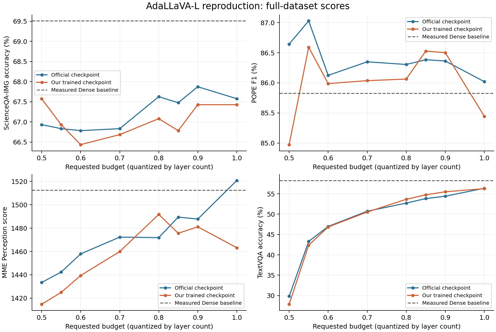
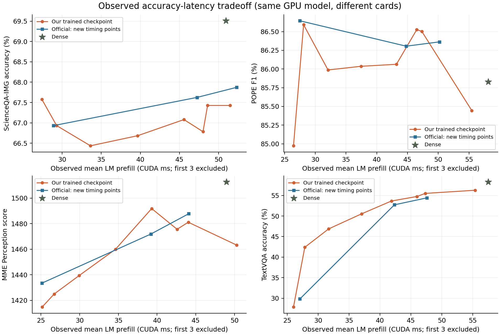

# AdaLLaVA-L 自主训练复现：正式结果与差距分析

整理日期：2026-10-31。结论：自主训练和本轮四benchmark评测均正常完成，主要预算—性能趋势接近官方checkpoint；**满预算MME仍存在明显差距，不能宣称原文全部指标已严格复现**。

本轮48组新实验（自主32、Dense4、官方补充12）全部完成且无失败；另复核并复用官方旧20组准确率，形成68个有效模型/任务/预算组合。全部来自完整样本、limit=None、batch1。两个队列分别于12:52和14:55 CST结束。

## 满预算：同环境实测对照

| 指标 | Dense实测 | 官方checkpoint实测 | 自主训练 | 自主−官方 |
|---|---:|---:|---:|---:|
| ScienceQA-IMG Accuracy (%) | 69.51 | 67.58 | 67.43 | -0.15 |
| POPE F1 (%) | 85.83 | 86.02 | 85.44 | -0.58 |
| MME Perception | 1512.56 | 1520.77 | 1463.21 | -57.56 |
| TextVQA consensus accuracy (%) | 58.28 | 56.37 | 56.28 | -0.10 |

百分数差值单位为百分点，MME差值单位为分。POPE采用F1，不混用Accuracy；MME只与论文Perception比较，不把Cognition加进去。

与原始Dense相比，自主模型满预算ScienceQA下降2.08个百分点、TextVQA下降2.01个百分点，POPE F1下降0.38个百分点、MME下降49.34分。接近官方checkpoint并不自动意味着完全保持Dense性能。

## 各预算准确率

| 请求budget | 模型 | ScienceQA (%) | POPE F1 (%) | MME Perception | TextVQA (%) |
|---:|---|---:|---:|---:|---:|
| 1.00 | 官方checkpoint | 67.58 | 86.02 | 1520.77 | 56.37 |
| 1.00 | 自主训练 | 67.43 | 85.44 | 1463.21 | 56.28 |
| 0.90 | 官方checkpoint | 67.87 | 86.36 | 1487.75 | 54.42 |
| 0.90 | 自主训练 | 67.43 | 86.50 | 1481.10 | 55.51 |
| 0.85 | 官方checkpoint | 67.48 | 86.38 | 1489.44 | 53.84 |
| 0.85 | 自主训练 | 66.78 | 86.53 | 1475.61 | 54.76 |
| 0.80 | 官方checkpoint | 67.63 | 86.31 | 1471.86 | 52.73 |
| 0.80 | 自主训练 | 67.08 | 86.06 | 1491.78 | 53.66 |
| 0.70 | 官方checkpoint | 66.83 | 86.35 | 1472.29 | 50.72 |
| 0.70 | 自主训练 | 66.68 | 86.04 | 1459.93 | 50.53 |
| 0.60 | 官方checkpoint | 66.78 | 86.12 | 1457.94 | 46.99 |
| 0.60 | 自主训练 | 66.44 | 85.99 | 1439.44 | 46.86 |
| 0.55 | 官方checkpoint | 66.83 | 87.03 | 1442.42 | 43.31 |
| 0.55 | 自主训练 | 66.93 | 86.59 | 1424.99 | 42.39 |
| 0.50 | 官方checkpoint | 66.93 | 86.64 | 1433.47 | 29.82 |
| 0.50 | 自主训练 | 67.58 | 84.97 | 1414.82 | 27.85 |

85%预算时，自主TextVQA比官方高0.92个百分点、POPE F1高0.14个百分点；60%预算时，ScienceQA、POPE F1、TextVQA与官方分别相差−0.35、−0.14、−0.13个百分点，MME低18.51分。

50%为只执行固定前16层的边界：自主TextVQA27.85%，官方29.82%；自主POPE F1低于官方1.67个百分点。两种checkpoint均表现出明显的TextVQA边界退化，不能用ScienceQA/POPE较稳定的分数概括所有任务。准确率不要求随预算严格单调：自主MME在80%预算为1491.78，高于其满预算1463.21，需如实呈现。

预算按floor(32×budget)量化，因此0.9/0.85/0.8/0.7/0.6/0.55分别执行28/27/25/22/19/17层，0.5为16层，1.0为32层；不是精确连续FLOPs比例。全部新自适应测量记录均满足预期层数、前16层固定执行及预算约束。

## 与论文同预算对比

来源：[ICCV2025 Table1](https://openaccess.thecvf.com/content/ICCV2025/papers/Xu_Learning_to_Inference_Adaptively_for_Multimodal_Large_Language_Models_ICCV_2025_paper.pdf)，普通AdaLLaVA-L/Vicuna7B，无token pruning。论文原始数值和PDF哈希保存在既有paper_comparison目录。论文是参考值，不能当作本机实测。

| Budget | 指标 | 原文 | 自主训练 | 差值 |
|---:|---|---:|---:|---:|
| 1.00 | ScienceQA-IMG Accuracy (%) | 67.80 | 67.43 | -0.37 |
| 1.00 | POPE F1 (%) | 85.90 | 85.44 | -0.46 |
| 1.00 | MME Perception | 1521.00 | 1463.21 | -57.79 |
| 1.00 | TextVQA consensus accuracy (%) | 57.00 | 56.28 | -0.72 |
| 0.85 | ScienceQA-IMG Accuracy (%) | 67.40 | 66.78 | -0.62 |
| 0.85 | POPE F1 (%) | 86.40 | 86.53 | +0.13 |
| 0.85 | MME Perception | 1487.20 | 1475.61 | -11.59 |
| 0.85 | TextVQA consensus accuracy (%) | 54.50 | 54.76 | +0.26 |
| 0.60 | ScienceQA-IMG Accuracy (%) | 66.90 | 66.44 | -0.46 |
| 0.60 | POPE F1 (%) | 86.10 | 85.99 | -0.11 |
| 0.60 | MME Perception | 1463.80 | 1439.44 | -24.36 |
| 0.60 | TextVQA consensus accuracy (%) | 47.70 | 46.86 | -0.84 |

共同三档内，ScienceQA、POPE F1、TextVQA各项绝对差均小于1个百分点；MME三档低57.79、11.59、24.36分。没有设定事后通过阈值，也不据单次训练称为统计等价。

Dense ScienceQA实测69.51%，高于论文表中的66.8%；其他Dense三项与论文较接近。因此“相对Dense保真率”也存在基线差异，不能直接复述论文平均保真率。尚未锁定该差异的唯一原因。

## MME满预算差距来自哪里

按官方MME聚合函数对保存的回答重新计分，类别和问题ID逐项匹配，总和与正式结果一致。每类最高200分，由问题准确率和同图两问全对率共同构成；并非普通总体准确率。

| 类别 | 题数 | 官方 | 自主 | 差值 |
|---|---:|---:|---:|---:|
| OCR | 40 | 140.00 | 110.00 | -30.00 |
| celebrity | 340 | 140.88 | 125.59 | -15.29 |
| posters | 294 | 144.56 | 131.29 | -13.27 |
| position | 60 | 148.33 | 140.00 | -8.33 |
| color | 60 | 175.00 | 170.00 | -5.00 |
| existence | 60 | 190.00 | 185.00 | -5.00 |
| count | 60 | 145.00 | 148.33 | +3.33 |
| artwork | 400 | 120.50 | 125.00 | +4.50 |
| landmark | 400 | 160.75 | 166.25 | +5.50 |
| scene | 400 | 155.75 | 161.75 | +6.00 |

感知部分共2114道题：官方对而自主错85道，自主对而官方错63道。OCR只有40题，其类别分数对少量错例比较敏感。全MME2374题中，自主无法解析为yes/no的回答3条，官方4条，Dense3条；现有证据不支持把差距简单归为普遍回答格式失败。

这将排查范围缩小到OCR、celebrity、posters等类别，但没有证明唯一训练原因。后续优先查看配对错例、对照输入/评分设置，再考虑受控配置或多seed验证；现阶段不应靠改评分规则或人为选点消除差距。

## 实测效率：与Dense按doc_id配对

每个组合排除最初3个冷启动/预热样本，并取与Dense共同doc_id。完整generate含视觉编码、LM prefill及decode，不含CPU图像预处理和tokenization；LM prefill为首次LM forward的CUDA事件时间。GPU型号相同但物理卡不同，未锁定时钟；下表是观察值，不能把小幅差异归因于Scheduler单一因素。生成token数不同也影响完整generate速度。

| 指标任务 | Budget | 自主LM prefill ms | 自主完整generate ms | LM prefill加速比 | 完整generate加速比 |
|---|---:|---:|---:|---:|---:|
| scienceqa_img | 1.00 | 51.47 | 80.40 | 0.99× | 0.94× |
| scienceqa_img | 0.85 | 48.00 | 74.75 | 1.06× | 1.01× |
| scienceqa_img | 0.60 | 33.62 | 54.83 | 1.51× | 1.37× |
| scienceqa_img | 0.50 | 27.43 | 46.62 | 1.86× | 1.61× |
| pope | 1.00 | 55.45 | 84.99 | 1.05× | 0.97× |
| pope | 0.85 | 46.51 | 72.14 | 1.25× | 1.15× |
| pope | 0.60 | 32.08 | 53.10 | 1.81× | 1.56× |
| pope | 0.50 | 26.46 | 45.38 | 2.20× | 1.82× |
| mme | 1.00 | 50.30 | 79.61 | 0.97× | 0.92× |
| mme | 0.85 | 42.59 | 69.09 | 1.15× | 1.06× |
| mme | 0.60 | 29.95 | 51.17 | 1.63× | 1.44× |
| mme | 0.50 | 25.16 | 44.61 | 1.95× | 1.65× |
| textvqa_val | 1.00 | 55.38 | 126.34 | 1.04× | 0.94× |
| textvqa_val | 0.85 | 45.97 | 112.89 | 1.25× | 1.05× |
| textvqa_val | 0.60 | 31.69 | 88.61 | 1.81× | 1.34× |
| textvqa_val | 0.50 | 26.02 | 87.96 | 2.21× | 1.35× |

60%预算完整generate观察加速约1.34–1.56×；50%约1.35–1.82×。满预算完整generate约0.92–0.97×，没有加速收益。不能把50%预算写成实测2×整机加速。

官方旧20组只复用准确率，其分析器prefill_time不作为新的硬件实测。图中官方新测时延仅含90%、80%、50%三个点。分析器FLOPs、roofline时间与本机CUDA事件分别保存在JSON，不混为同一种测量。

Scheduler forward在85%预算约1.07–1.11ms（不同benchmark均值），仅为事件计时观察；不代表完整附加训练/推理成本。Latency token对前缀层的影响、训练forward/backward额外成本仍需专门profiling。

## 训练与验证范围

正式训练5197更新正常结束，最后checkpoint和三份portable权重校验/重载通过。模型入口耗时约55.99小时，约111.97 GPU-hours；最后loss0.6608、全程均值约0.87086。可训练参数6,777,295,376，Scheduler新增17,900,048。Training FLOPs未可靠实测。

核心训练方法保持原实现。global128由Stage-2及附录约5200步曲线支持，但作者卡数未明确公开；两卡累积32替代脚本累积4。初始化seed时机、Blackwell软件环境和必要兼容修复详见[严格配置审计](../training_repro/STRICT_ALIGNMENT_REVIEW.md)。不能把这些差异说成已被消除，也不能仅凭当前分数确定其因果贡献。

当前完成的是4个benchmark、8个预算的自主/官方准确率对照及Dense4组，还有实际成本与逐样本路由记录。MMBench缺少官方judge凭据，尚未完成；VQAv2未纳入本轮。统一同卡profiling、Scheduler训练额外开销、跨输入routing分布和Fig.4真实attention可视化仍是后续分析项，不宣称整篇论文全部实验已复现。

## 可追溯资料

- [68组复核结果及配对效率](evidence/validated_results_68.json)：包含指标名、样本数、原始文件路径及SHA。
- [MME类别及配对错例](evidence/mme_diagnosis.json)。
- [训练完成成本](../training_repro/evidence/training_completed_20261030.json)。
- [评测启动与恢复说明](HANDOFF_20261031.md)。
- 服务器原始结果：`/home/SigConv/cys/AdaLLaVA/evaluation_repro/20261031/{reproduced,dense,official}/outputs/formal/`；旧20组留在原`outputs/formal/`。
- 结果离线复核脚本副本：`reproduction/evaluation/analyze_results.py`、`diagnose_mme.py`、`plot_results.py`、`build_results_report.py`。
